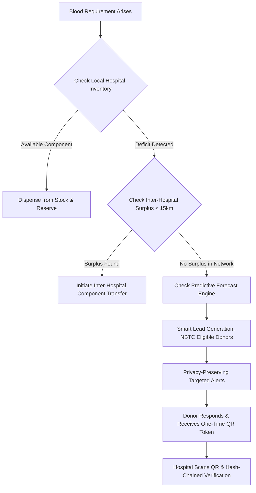

# PROJECT REPORT: BloodBridge 2.0
## A Predictive, Stock-First Coordination & Smart Matching Network for Blood & Blood Components

**Event:** VITB – JHU Health Hack 2027  
**Track:** Healthcare Delivery & Emergency Coordination Systems  
**Project Name:** BloodBridge  
**Subtitle:** Moving from Reactive Chaos to Predictive, Stock-First Coordination  
**Team Name:** Team BloodBridge Innovation  
**Team Members:** Devesh & Collaborators (VIT Bhopal & Johns Hopkins Healthcare Innovation Track)  
**Date of Submission:** October 2026  

---

## 1. Executive Summary

Blood transfusion is a cornerstone of modern emergency medicine, oncology, surgery, and chronic hematological care. Yet, in India and developing healthcare ecosystems, emergency blood procurement remains predominantly **reactive, uncoordinated, and frantic**. When an acute shortage or trauma incident occurs, patient attendants resort to broadcasting desperate pleas over informal WhatsApp groups and social media channels. This results in dangerous delays, panic, stale leads, donor fatigue, and severe privacy violations.

**BloodBridge 2.0** transforms blood procurement from a **reactive emergency scramble into a predictive, stock-first ecosystem**:
1. **Predictive Shortage Forecasting:** Leverages seasonal epidemiology (dengue-induced thrombocytopenia, monsoon trauma spikes) and scheduled surgical loads to predict blood group deficits 3 to 7 days in advance.
2. **Stock-First Hierarchy:** Before disturbing volunteer donors, the platform checks intra-hospital component inventories (Whole Blood, PRBC, Platelets, FFP) and triggers **inter-hospital surplus transfers**, routing near-expiry components (e.g., platelets with 5-day shelf life) to where they are needed.
3. **Smart Matching Engine:** Evaluates **NBTC-mandated donor eligibility intervals** (90 days for men, 120 days for women), real-time road traffic ETA, past donor reliability scoring, and dedicated cross-city protocols for **rare blood groups (Bombay Phenotype hh, Rh-null)**.
4. **Verifiable Trust & Compliance:** Incorporates **SHA-256 tamper-evident hash-chained audit trails**, one-time **QR-code check-ins**, and bidirectional alignment with the Government of India’s **e-RaktKosh** database under the **Digital Personal Data Protection (DPDP) Act 2023**.
5. **Universal Accessibility:** Bridges digital divides through a **WhatsApp Chatbot Front Door**, interactive two-way SMS (`Reply 1 to Accept`), and IVR voice systems.

---

## 2. Problem Statement & Real-World Context

### 2.1 The Reality of India’s Blood Deficit
According to official data from the **World Health Organization (WHO)** and the **National Blood Transfusion Council (NBTC/CDSCO)**:
* WHO recommends that at least **1% of a nation's population** should donate blood annually to meet minimum requirements. For India (~1.42 billion citizens), this represents a baseline demand of **~14.2 million units**.
* India collects approximately **11.5 to 12.2 million units annually**, creating a structural national deficit of **1.5 to 2.5 million units each year**.
* The shortage is exacerbated by severe geographic maldistribution: urban multi-specialty centers encounter acute shortages during peak surgical and dengue periods, while smaller districts suffer from inadequate cold-chain blood component separation facilities.

```
┌────────────────────────────────────────────────────────────────────────┐
│                        THE STATUS QUO CRISIS                           │
├────────────────────────────────────────────────────────────────────────┤
│ 1. Emergency Trauma / Dengue Shock                                     │
│    └─► Hospital blood bank stock depleted                              │
│ 2. Attendant Panics                                                    │
│    └─► Unvetted WhatsApp / Instagram broadcasts                        │
│ 3. Chaos & Stale Leads                                                 │
│    └─► 50 phone calls made to ineligible or distant donors             │
│ 4. Delayed Transfusion                                                 │
│    └─► 2 to 6 hours lost; preventable morbidity & mortality           │
└────────────────────────────────────────────────────────────────────────┘
```

### 2.2 The Chronic Challenge: Standing Patients
India is home to an estimated **100,000+ patients living with Thalassemia Major** and thousands of sickle-cell disease and oncology patients requiring transfusions every 15 to 21 days. For these families, finding blood is not a one-time emergency—it is a perpetual, exhausting crisis that traditional emergency hotlines fail to resolve.

---

## 3. Competitive Analysis & The BloodBridge Edge

| Dimension | e-RaktKosh (Govt. Portal) | Friends2Support | Red Cross Blood App | Informal WhatsApp / Social Media | **BloodBridge 2.0** |
| :--- | :--- | :--- | :--- | :--- | :--- |
| **Operational Model** | Static Stock Directory | Unverified Donor List | Centralized Donor Registry | Unstructured broadcasts | **Predictive & Multi-Tier Coordination** |
| **Stock-First Transfer** | ❌ View only; no automated inter-hospital transfer | ❌ No stock data | ❌ Internal blood bank only | ❌ None | **✅ Automated surplus transfer before alerting donors** |
| **Demand Forecasting** | ❌ Purely reactive | ❌ None | ❌ None | ❌ None | **✅ 3–7 day AI shortage projection (Dengue, Monsoons)** |
| **Eligibility Enforced** | ❌ Not tracked | ❌ Donors self-report | ⚠️ Manual card entry | ❌ Zero verification | **✅ Enforces 90/120-day NBTC intervals automatically** |
| **Standing Patients** | ❌ Not supported | ❌ Not supported | ❌ Limited | ❌ Repeated monthly pleading | **✅ Dedicated Thalassemia & Oncology circles** |
| **Rare Blood Groups** | ❌ Standard ABO only | ⚠️ Incomplete search | ⚠️ Manual registry | ❌ Ineffective | **✅ Cross-city Bombay Phenotype (hh) registry** |
| **Privacy Standards** | ⚠️ Government ID linked | ❌ Phone numbers public | ⚠️ Standard policy | ❌ Extreme public exposure | **✅ DPDP Act 2023, Coarse Geohash, Masked Routing** |
| **Verification Loop** | ⚠️ Paper receipt | ❌ None | ⚠️ Manual record | ❌ None | **✅ Cryptographic Hash-Chain & QR Check-in** |

---

## 4. The 3-Tier Hierarchy: Prevent, Transfer, Mobilize

Rather than triggering panic broadcasts, BloodBridge operates on a strict **Stock-First Decision Tree**:



### Step 1: Component-Specific Inventory & Near-Expiry Routing
Whole blood is separated into:
* **Packed Red Blood Cells (PRBC):** Shelf life of 35–42 days.
* **Platelets (RDP / SDP):** Fragile shelf life of only **5 days**.
* **Fresh Frozen Plasma (FFP):** Stable up to 1 year when frozen at -30°C.

BloodBridge tags component batches with live expiry countdowns. Units nearing expiry (e.g., platelets with < 48 hours remaining) are prioritized for immediate matching with scheduled patients across the hospital cluster, preventing critical wastage.

### Step 2: Inter-Hospital Surplus Transfer Logic
If Hospital A has zero B+ platelets but Hospital B (4.2 km away) holds a verified surplus above its safety threshold, BloodBridge orchestrates an inter-facility transfer reservation. **Result:** The patient receives blood immediately; voluntary donors are spared unnecessary emergency summons.

### Step 3: Predictive & Smart Matching (Only When Deficit Persists)
When external donor mobilization is necessary, the matching engine enforces:
* **NBTC Eligibility Guard:** Rejects any donor who has donated whole blood within 90 days (males) or 120 days (females), or platelets within 14 days.
* **Traffic-Aware ETA:** Utilizes road network speeds rather than misleading geometric radius.
* **Donor Reliability Index:** Weights candidates by past response and verified show-up rates.
* **Bombay Phenotype Protocol:** Automatically widens search coordinates to state and national registries when rare phenotypes (hh, Rh-null, Bombay blood group) are requested.

---

## 5. System Architecture & Technical Specifications

```
┌────────────────────────────────────────────────────────────────────────┐
│                        BLOODBRIDGE 2.0 ARCHITECTURE                    │
├────────────────────────────────────────────────────────────────────────┤
│  CHANNELS: Web Dashboard │ WhatsApp Bot │ 2-Way SMS / IVR Voice        │
├────────────────────────────────────────────────────────────────────────┤
│  SECURITY & COMPLIANCE: DPDP Act 2023 │ SHA-256 Hash-Chain Audit      │
├────────────────────────────────────────────────────────────────────────┤
│  SERVICES:                                                             │
│   ├── 1. Predictive Demand Engine (Seasonal & Surgical Analytics)      │
│   ├── 2. Live Component Stock & Inter-Hospital Transfer Manager        │
│   ├── 3. Smart Matching Engine (NBTC 90/120d, ETA, Reliability Score)  │
│   ├── 4. Standing Patient Module (Thalassemia Scheduled Circles)       │
│   └── 5. e-RaktKosh API Sync & Tokenized QR Verification Gateway       │
├────────────────────────────────────────────────────────────────────────┤
│  DATA STORES: PostgreSQL (ACID) │ Redis Cache │ Geohash Spatial Index  │
└────────────────────────────────────────────────────────────────────────┘
```

### 5.1 Tamper-Evident SHA-256 Hash Chaining
Every clinical state change—from request dispatch to hospital pathologist cross-match—generates a cryptographic block:
$$\text{Block Hash} = \text{SHA256}(\text{Index} + \text{Timestamp} + \text{RequestID} + \text{Action} + \text{VerifiedBy} + \text{PreviousHash})$$
Any retroactive modification of hospital logs breaks the cryptographic chain, providing an immutable audit trail compliant with medical-legal standards.

### 5.2 Tokenized QR-Code Check-In
When an alert is accepted, the donor receives an ephemeral, encrypted QR token. Upon arrival at the hospital blood bank:
1. Hospital staff scan the QR code via the BloodBridge partner console.
2. The system validates donor identity, checks against the NBTC interval database, and closes the communication loop: `Alert Sent → Accepted → Arrived → Verified → Donated`.

---

## 6. Standing-Patient Module: Thalassemia & Oncology Circles

Rather than subjecting chronic patients to recurring distress:
* Patients register their prescribed transfusion cycle (e.g., every 18 days).
* BloodBridge pairs each patient with a **"Dedicated Life Circle"** of 4–6 pre-consented, compatible voluntary donors.
* The system schedules rotation cycles in advance: Donor A donates in Month 1, Donor B in Month 2, ensuring each donor stays comfortably within their 90/120-day NBTC window while the patient enjoys unbroken supply security.

---

## 7. Legal, Privacy & DPDP Act 2023 Compliance

1. **Digital Personal Data Protection Act (DPDP Act 2023):** BloodBridge implements consent managers, clear notice mechanisms, purpose limitation, and mandatory breach notification safeguards.
2. **Coarse Geohash Bucketing:** Exact donor GPS coordinates are never stored or transmitted. The system converts coordinates into 5-character geohash buckets (~1.2 km precision radius), masking donor residences while calculating accurate transit times.
3. **Right to Erasure & Data Dashboard:** Donors have continuous access to their profile, consent logs, donation history, and a one-click "Delete My Data" feature.
4. **Clinical Gate & False Positive Handling:** If a prospective donor misrepresents their medical fitness during online opt-in, BloodBridge's hospital verification gate catches it: all physical donations require mandatory Hb testing, TTI screening (HIV, Hepatitis B/C, Syphilis, Malaria), and blood typing by licensed clinical staff before transfusion.

---

## 8. Financial Sustainability & Business Model

Voluntary blood donation must remain **100% non-remunerated** in strict adherence with WHO guidelines and the Supreme Court of India ruling (1996). The platform sustains itself through:

1. **Hospital & Health System B2B Subscriptions (SaaS):** Private hospital chains and blood banks pay a modest tier fee for inter-hospital stock coordination, inventory waste reduction, and digital accreditation logs.
2. **Corporate Social Responsibility (CSR) Grants:** Healthcare and enterprise CSR foundations sponsor municipal blood availability drives and college campus leaderboards.
3. **Public-Private Partnerships (PPP):** Integration grants from State Blood Transfusion Councils (SBTC) to augment e-RaktKosh efficiency and eliminate urban blood shortages.
4. **Donor & Patient Access:** Guaranteed free forever. No registration fees, advertisements, or transaction surcharges.

---

## 9. Quantified Pilot Targets & Evaluation Metrics

| Metric | Current Baseline (Informal / Status Quo) | BloodBridge Phase 1 Target (Hospital Pilot) |
| :--- | :---: | :---: |
| **Time to First Verified Response (TTFR)** | 90 to 240 minutes | **< 12 minutes** |
| **Request Fulfillment Rate** | ~48% (scattered leads) | **≥ 88% within clinical window** |
| **Stock Wastage (Platelet Expiries)** | 15%–22% component discards | **< 4% via near-expiry transfers** |
| **Donor Response & Conversion Rate** | 6%–10% on social posts | **35%–45% via targeted smart matching** |
| **Thalassemia Circle Adherence** | 55% timely transfusions | **95% on-schedule scheduled transfusions** |
| **Data Privacy Violations** | 100% phone exposure | **0% (full masking & DPDP compliance)** |

---

## 10. References & Regulatory Authorities

1. **World Health Organization (WHO):** *Blood Safety and Availability* (Fact Sheet N°279) — Recommending national blood supply self-sufficiency through voluntary non-remunerated donations.
2. **National Blood Transfusion Council (NBTC), Ministry of Health & Family Welfare, Govt. of India:** *Guidelines on Blood Donor Selection and Blood Donor Referral* (mandating donor intervals, Hb thresholds, and collection standards).
3. **Drugs and Cosmetics Act, 1940 & Rules 1945 (Part XII-B):** Requirements for collection, storage, testing, and distribution of blood components.
4. **Digital Personal Data Protection Act (DPDP Act, 2023):** Standards for digital health consent, coarse geohashing, and data principal autonomy.
5. **e-RaktKosh National Blood Bank Directory:** National Health Mission, Government of India.
6. **Thalassemia International Federation (TIF):** Standards for regular clinical transfusion protocols and safety margins.

---
*Report published for VITB – JHU Health Hack 2027 by Team BloodBridge.*
